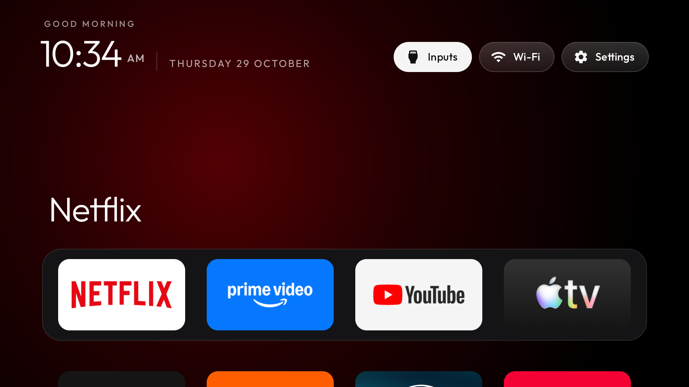

# AmazingUltraTV

An Apple TV-style home screen for Android TV and Google TV: a black home screen, a large top shelf for the focused app, a dock of favourites, an app grid that slides up, and a clock screensaver. It is a small native Java app with no internet permission, no tracking and no ads.



Built and tested on a Philips 4K Smart TV (Google TV, Android 11, 1.7 GB RAM).

## What's in this repo

| Folder | What it is |
| --- | --- |
| `launcher/` | The Android app (Java, Gradle) |
| `themes/` | Ready-made looks; a theme is a `config.json` pushed to the TV, no rebuild needed |
| `scripts/` | PowerShell scripts to back up the TV, build and install the app, push themes and sync upstream |
| `backups/` | Local snapshots of your TV's state (never committed) |

## Setup on Windows

Install the tools once:

```powershell
winget install Google.PlatformTools
winget install Microsoft.OpenJDK.17
```

Then install the Android SDK command-line tools into `%LOCALAPPDATA%\Android\Sdk\cmdline-tools\latest` and add `platforms;android-34` and `build-tools;34.0.0` with `sdkmanager`.

On the TV: **Settings → System → About**, press OK seven times on **Android TV OS build**, then turn on **USB debugging** in **Developer options**.

## Use

The scripts need your TV's IP address (on the TV: **Settings → Network & Internet**, then your network). Pass it with `-TvHost <tv-ip>`, or save it once for your Windows user so you never have to type it:

```powershell
[Environment]::SetEnvironmentVariable('AUT_TV_HOST', '<tv-ip>', 'User')
```

Open a new terminal after saving it. Then:

```powershell
powershell -ExecutionPolicy Bypass -File scripts\backup-tv.ps1
powershell -ExecutionPolicy Bypass -File scripts\build.ps1
powershell -ExecutionPolicy Bypass -File scripts\install.ps1
powershell -ExecutionPolicy Bypass -File scripts\push-theme.ps1 themes\glass
```

- `backup-tv.ps1` saves the TV's apps and settings to `backups\<date>`.
- `install.ps1` installs and opens the launcher, but leaves the TV's default home screen alone.
- `push-theme.ps1` applies a theme from `themes/`; `-Reset` goes back to the built-in look.

## Undo

```powershell
adb uninstall com.amazingultratv.home
```

Each `backups\<date>` folder lists every app and setting as it was, so anything changed on the TV can be put back.

## Credits

AmazingUltraTV is built on [CleanYourTV](https://github.com/Gathin23/cleanyourtv) (formerly tv-vibehack) by Gathin, under the MIT licence. [CREDITS.md](CREDITS.md) explains what came from CleanYourTV, what AmazingUltraTV changed, and the licences of the font, icons and theme wallpapers. [UPSTREAM.md](UPSTREAM.md) records which CleanYourTV version we're based on.

## Licence

MIT, see [LICENSE](LICENSE). The font, emoji pictures and theme wallpapers keep their own licences, listed there and in [CREDITS.md](CREDITS.md).

## Trademarks

AmazingUltraTV is an independent project. It is not affiliated with, endorsed by or sponsored by Apple, Google or Philips. "Apple TV" describes the style of the home screen. Apple TV, Google TV, Android TV and Philips are trademarks of their owners, as are the app names and logos in the screenshot.
